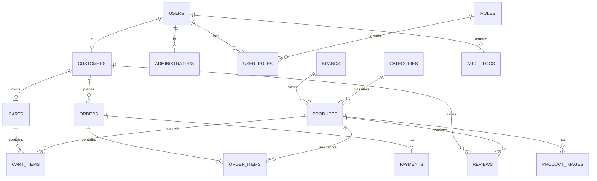

# Architecture and database design

This document is the Phase 2 design baseline. It defines the boundaries that
implementation must follow. Runtime code must not introduce undocumented tables,
endpoints, or security behavior.

## Confirmed decisions

| Area | Decision |
|---|---|
| Backend | Spring Boot 3, Spring MVC, Spring Data JPA, Spring Security |
| Authentication | Server-side session with an HttpOnly cookie |
| User inheritance | JPA `JOINED` strategy for `User`, `Customer`, and `Administrator` |
| Database | PostgreSQL with Flyway migrations |
| Image storage | Validated local filesystem files; database stores metadata and relative paths |
| Payments | Stripe Checkout Session in test mode; verified webhook finalizes payment |
| API | JSON REST under `/api/v1` |
| Errors | Consistent JSON problem response with request correlation ID |

## Layered architecture

```text
HTTP request
  -> security filters and session authentication
  -> controller: transport validation and HTTP mapping
  -> service: business rules, authorization, transactions
  -> repository: parameterized JPA persistence access
  -> PostgreSQL / validated filesystem storage
```

- `controller` exposes DTOs and never exposes persistence entities directly.
- `service` owns business rules, ownership checks, role checks, and transaction
  boundaries.
- `repository` contains persistence queries and must not build SQL from raw user
  input.
- `domain` contains entities, value objects, enums, and domain rules.
- `security` contains password hashing, session policy, CSRF, authorization, and
  security event handling.
- `configuration` contains externalized settings and infrastructure wiring.
- `exception` contains typed application exceptions and global error mapping.

The frontend is separated into routes/pages, reusable components, API clients,
authentication state, and styles. It treats the API as the only source of server
state.

## Entity relationship design



## 3NF schema

All tables use a generated UUID primary key unless otherwise noted. Foreign keys
are indexed where they participate in lookups. Money is stored as a fixed-scale
numeric value, never a floating-point type.

| Table | Important columns and constraints |
|---|---|
| `users` | `id`, `email` unique, `password_hash`, `display_name`, `enabled`, timestamps |
| `customers` | `user_id` PK/FK to `users` |
| `administrators` | `user_id` PK/FK to `users` |
| `roles` | `id`, `code` unique |
| `user_roles` | `user_id`, `role_id`, composite PK and two FKs |
| `brands` | `id`, `name` unique, `description` |
| `categories` | `id`, `name` unique, `description` |
| `products` | `id`, `brand_id`, `category_id`, `name`, `description`, `price`, `stock_quantity`, `active`, timestamps |
| `product_images` | `id`, `product_id`, `storage_path` unique, `original_filename`, `mime_type`, `byte_size`, `content_hash`, `sort_order`, `alt_text` |
| `carts` | `id`, `customer_id` unique, timestamps |
| `cart_items` | `cart_id`, `product_id`, `quantity`, composite PK, quantity check |
| `orders` | `id`, `customer_id`, `status`, `currency`, `subtotal`, `total`, idempotency key unique, timestamps |
| `order_items` | `id`, `order_id`, `product_id` nullable after product removal, product name snapshot, unit price snapshot, quantity, line total |
| `payments` | `id`, `order_id` unique, provider, provider session ID unique, status, amount, currency, timestamps |
| `reviews` | `id`, `customer_id`, `product_id`, rating check 1–5, title, body, unique customer/product pair, moderation status |
| `audit_logs` | `id`, actor user ID nullable, action, resource type, resource ID, outcome, request ID, created timestamp; no secrets or credentials |

The `JOINED` inheritance tables preserve normalized shared user attributes while
keeping role-specific identity explicit. Roles remain authorization data; the
subclass type is not used as the sole authorization check.

Order items deliberately duplicate product name and price as immutable snapshots.
These are historical facts at order time, so they do not violate 3NF.

## API contract

### Common rules

- Base path: `/api/v1`
- JSON request and response bodies use camelCase.
- Collection responses use `{ "items": [], "page": 0, "size": 20, "totalItems": 0, "totalPages": 0 }`.
- Errors use `application/problem+json`:

```json
{
  "type": "https://fragrance.example/problems/validation",
  "title": "Validation failed",
  "status": 400,
  "detail": "One or more fields are invalid.",
  "requestId": "correlation-id",
  "fieldErrors": { "price": "Must be greater than zero." }
}
```

- Mutating requests require the session CSRF token and an `Idempotency-Key` where
  duplicate submission could create an order or payment.
- Pagination has bounded `size`; sorting accepts only an allow-listed field.

### Authentication

| Method | Endpoint | Access | Purpose |
|---|---|---|---|
| `POST` | `/auth/register` | Guest | Create a customer |
| `POST` | `/auth/login` | Guest | Authenticate and issue HttpOnly session cookie |
| `POST` | `/auth/logout` | Authenticated | Invalidate the session |
| `GET` | `/auth/me` | Authenticated | Return the current user and roles |
| `GET` | `/auth/csrf` | Guest | Return a CSRF token for the SPA |

### Public catalogue

| Method | Endpoint | Access | Purpose |
|---|---|---|---|
| `GET` | `/products` | Guest | Search, filter, sort, and paginate active products |
| `GET` | `/products/{productId}` | Guest | Product details and image metadata |
| `GET` | `/brands` | Guest | List active brands |
| `GET` | `/categories` | Guest | List active categories |

### Customer operations

| Method | Endpoint | Access | Purpose |
|---|---|---|---|
| `GET` | `/cart` | Customer | Read the current customer's cart |
| `POST` | `/cart/items` | Customer | Add or increment a product quantity |
| `PATCH` | `/cart/items/{productId}` | Customer | Change quantity |
| `DELETE` | `/cart/items/{productId}` | Customer | Remove an item |
| `POST` | `/orders` | Customer | Create an immutable order from the cart |
| `GET` | `/orders` | Customer | List only the current customer's orders |
| `GET` | `/orders/{orderId}` | Customer | Read an owned order |
| `POST` | `/orders/{orderId}/checkout` | Customer | Create a Stripe test Checkout Session |
| `POST` | `/products/{productId}/reviews` | Customer | Submit a review |

### Administrator operations

| Method | Endpoint | Access | Purpose |
|---|---|---|---|
| `POST` | `/admin/products` | Administrator | Create a product |
| `PATCH` | `/admin/products/{productId}` | Administrator | Edit a product |
| `DELETE` | `/admin/products/{productId}` | Administrator | Delete/deactivate a product |
| `POST` | `/admin/products/{productId}/images` | Administrator | Upload a validated image |
| `DELETE` | `/admin/products/{productId}/images/{imageId}` | Administrator | Remove an image |
| `GET` | `/admin/orders` | Administrator | Search and paginate all orders |
| `PATCH` | `/admin/orders/{orderId}/status` | Administrator | Apply an allowed order transition |

### Payment webhook

| Method | Endpoint | Access | Purpose |
|---|---|---|---|
| `POST` | `/webhooks/stripe` | Stripe signature | Verify the raw signature and finalize payment idempotently |

Webhook processing uses the provider event ID as an idempotency key. Browser return
pages display a pending or final state; they do not decide payment success.

## Security boundaries

- Passwords use a modern adaptive password hash and are never logged.
- Session cookies are `HttpOnly`, `Secure` in deployment, `SameSite=Lax`, and
  invalidated on logout.
- CSRF protection applies to all state-changing session requests.
- CORS allows only configured frontend origins and credentials when required.
- Spring/JPA parameter binding and allow-listed sorting prevent SQL injection.
- DTO validation runs at the controller boundary and domain checks run in services.
- Product uploads are limited to 12 MB, approved extensions and MIME types,
  detected content signatures, image decoding, metadata inspection, and a
  generated storage name outside the public source tree.
- Downloaded images are served through an authorization-aware endpoint or a
  non-executable static location.
- Rate limiting, CAPTCHA, security headers, and proxy resource protection are
  Phase 8 deployment/security controls and must have explicit tests/evidence.
- Audit logs record authentication, authorization failures, administrative changes,
  upload outcomes, and payment state changes without tokens, passwords, card data,
  or raw webhook secrets.

## Phase 2 exit-gate checklist

- [x] Architecture layers and responsibilities are defined.
- [x] ERD and 3NF schema are documented.
- [x] REST endpoints, response shapes, errors, and pagination are documented.
- [x] Authentication, authorization, upload, logging, and payment boundaries are defined.
- [x] Inheritance and payment service interface decisions are explicit.
- [ ] Design review approval is recorded before Phase 3 or feature implementation.
